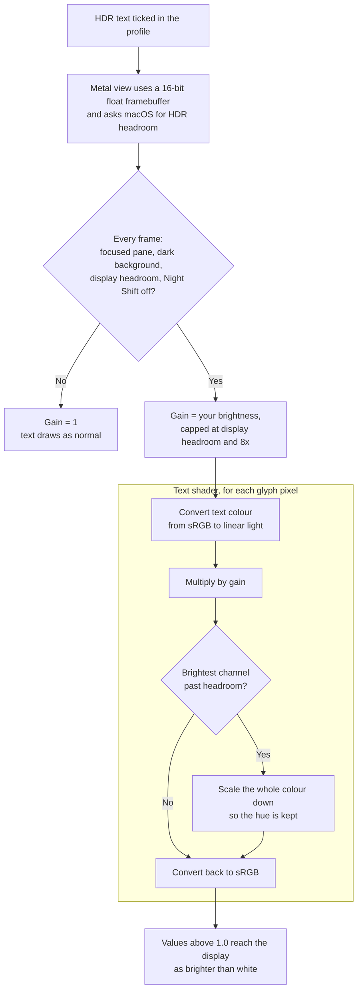

# iTerm2 HDR text

A patch for [iTerm2](https://github.com/gnachman/iTerm2) that draws the text in
the focused pane brighter than white on an HDR display, plus a script that
builds a patched copy and installs it next to your normal iTerm2.

It builds on iTerm2's HDR cursor. Brightness is a multiple of normal white
(1.5x to 8x, default 3x), applied in linear light, so colours keep their hue.

<!--
  PHOTO PLACEHOLDER
  Save a photo of the screen as images/hdr-text.jpg, then delete the
  "Photo coming soon" line below and remove this comment's opening and closing
  markers so the image tag is live. It has to be a camera photo: a screenshot
  cannot capture brightness above white.


-->

> **Photo coming soon.** A screenshot can't show this, because screenshots
> don't record brightness above white.

## Build

You need a Mac with an HDR display and Xcode 26 or newer.

```sh
git clone https://github.com/ahnafaf/iterm2-modified-hdr.git
cd iterm2-modified-hdr
bash build-iterm2-hdr.sh
```

The script clones iTerm2 into `~/src/iTerm2-hdr`, applies
`iterm2-hdr-text.patch`, builds an optimized app (10 to 20 minutes the first
time) and installs it as `~/Applications/iTerm2 HDR.app`. It is safe to re-run
after a failure. Set `ITERM_SRC` to use a different checkout directory.

## Staying up to date

iTerm2 changes daily, so the patched build needs to follow it.

```sh
bash build-iterm2-hdr.sh --update      # once, now
bash build-iterm2-hdr.sh --schedule    # every week, in the background
```

`--update` fetches the newest iTerm2, replays the patch on top with git,
rebuilds and installs. `--schedule` sets up a background job that does the same
about once a week: it checks daily at 12:30, skips the build on battery, and
posts a notification when something happens. `--unschedule` removes it. The
job's log is `~/Library/Logs/iterm2-hdr-update.log`.

The background job runs from its own copy of the script and patch in
`~/Library/Application Support/iterm2-hdr-update`, because macOS does not let
background jobs read folders such as Documents. Run `--schedule` again after
you change the script or the patch.

An update is careful about three things:

- **It never replaces the app while it is running.** If iTerm2 HDR is open, the
  new build waits and is swapped in as soon as you quit it.
- **It stops when the patch no longer fits.** If iTerm2 changed the same lines
  the patch does, the checkout is put back the way it was, the installed app is
  left alone, and you are told which files collided. That needs a manual
  rebase of the `hdr-text` branch in the checkout.
- **It keeps the previous build.** `bash build-iterm2-hdr.sh --rollback` puts
  back the build the last install replaced, for when a new iTerm2 misbehaves.

It follows iTerm2's development branch, so each update is as stable as that
day's nightly.

If you maintain your own copy of this repository, add `--push` to `--update` or
`--schedule`. After an update that built successfully, the script rewrites
`iterm2-hdr-text.patch` and `base-commit` (the iTerm2 commit the patch was last
replayed on) when the patch itself changed, then commits and pushes them. With
`--schedule --push` the job's copy is a clone of your repository's `origin`
that it pulls before each update, so commit and push before scheduling.

## Turn it on

1. Quit your normal iTerm2, then open `~/Applications/iTerm2 HDR.app`. Both
   copies share one bundle ID, so they would fight over settings.
2. Settings > Profiles > Colors: tick **HDR text in focused pane** and pick a
   brightness. With "Use separate colors for light and dark mode" on, the
   setting is per mode.
3. Settings > General > Magic: untick "Disable GPU rendering when disconnected
   from power" if you want HDR text on battery.
4. Settings > General: turn off automatic update checks, or iTerm2's own
   updater may replace this build with a stock release. Use `--update` or
   `--schedule` to stay current.

## When text is boosted

All of these have to be true:

- The profile has HDR text on for the current light or dark mode.
- The pane is the active one in the key window. Other panes, and every pane
  while another window such as Settings has focus, draw normally.
- The profile's background colour is dark.
- The GPU renderer is in use.
- The display has HDR headroom.
- Night Shift is off. To keep HDR text on during Night Shift, search
  "Night Shift" in Settings > Advanced.

The cursor cell and emoji are not boosted.

## How it works

A normal window tops out at "white", which on an HDR display is well below the
brightest the panel can go. macOS calls the room above white EDR headroom, and
an app can use it by drawing pixel values greater than 1.0. The patch makes
only the text do that, so the background stays where it was and the text
stands out against it.



1. **A framebuffer that can hold values above white.** iTerm2's GPU renderer
   normally draws into an 8-bit buffer, where 1.0 is the largest value. When a
   profile has HDR text (or the HDR cursor) on, the session's Metal view
   switches to a 16-bit float buffer in an extended-range colour space and
   asks macOS for headroom. The pixel format is baked into the renderer's
   pipelines, so flipping the setting rebuilds the renderer for that tab.

2. **A gain worked out for every frame.** Before each frame, iTerm2 checks the
   conditions listed above. If any fails, the gain is 1 and the text draws
   exactly as before. Otherwise the gain is the brightness you picked, capped
   at what the display reports it can reach and at 8x. Because this is
   decided per frame, the glow follows focus as you switch panes, tabs and
   apps.

3. **The boost happens in the text shader.** For each glyph pixel the shader
   converts the text colour from sRGB to linear light, multiplies it by the
   gain, and converts back. Working in linear light is what makes "3x" mean
   three times the light. If the brightest channel would go past the
   display's headroom, the whole colour is scaled down together, so a
   saturated red stays red and doesn't wash out toward white. Underlines
   get the same boost. Glyph coverage is still computed from the original
   colour, so text keeps its normal stroke weight.

4. **Night Shift.** macOS has no public API for Night Shift, so the patch
   loads the private CoreBrightness framework at runtime and asks it whether
   Night Shift is on. It listens for changes, and also re-checks once a
   minute and after wake. If that private API is missing or changes, Night
   Shift is treated as off, so the worst case is HDR text staying on at
   night.

The patch only holds the display in HDR while HDR text can actually draw. When
the GPU renderer is off (iTerm2's default on battery) or Night Shift is
suppressing it, the headroom is released, unless the HDR cursor is also on.

## License

The patch is a modification of iTerm2 and is distributed under iTerm2's
license. See the iTerm2 repository for the terms.
